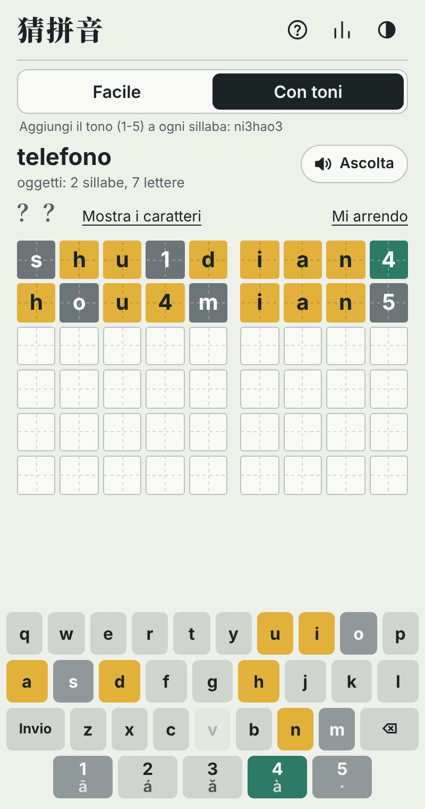

# 猜拼音 (Cāi pīnyīn)

Gioca: apri `index.html` nel browser, senza installare nulla. Indovina la parola cinese di base scrivendo il suo **pinyin**; l'indizio è il significato in italiano.

- Hai 6 tentativi. Verde: lettera giusta al posto giusto. Giallo: c'è, ma altrove. Grigio: non c'è.
- **Facile**: solo lettere. **Con toni**: dopo ogni sillaba scrivi il numero del tono, per esempio `ni3hao3`.
- Dopo 3 errori compaiono i caratteri. Con **Ascolta** senti la parola.
- **Mi arrendo** mostra la soluzione (conta come partita persa).
- A fine partita vedi come è fatta la parola: il significato di ogni carattere e se, da solo, ha senso oppure no.

Un Wordle per chi comincia a studiare il cinese.

| Partita con toni | Fine partita |
|---|---|
|  |  |

## I toni

| Numero | Tono | Esempio |
|:---:|---|---|
| 1 | alto e piatto | mā, mamma |
| 2 | sale | má, canapa |
| 3 | scende e risale | mǎ, cavallo |
| 4 | scende di colpo | mà, sgridare |
| 5 | neutro, breve e leggero | ma |
