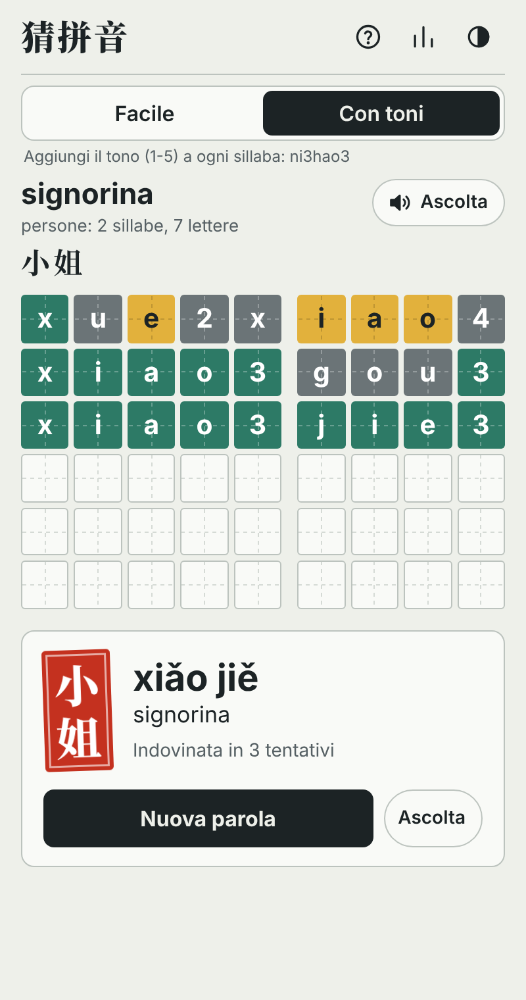

# 猜拼音 (Cāi pīnyīn)

Un Wordle per chi comincia a studiare il cinese. Si indovina una parola di base scrivendo il suo **pinyin**; l'indizio è il significato in italiano. Funziona nel browser, senza installare nulla e senza librerie esterne.

| Partita con toni | Parola indovinata |
|---|---|
|  |  |

## Come si gioca

- Hai 6 tentativi per scrivere il pinyin della parola. Le caselle sono raggruppate per sillaba.
- Verde: lettera giusta al posto giusto. Giallo: la lettera c'è, ma in un'altra posizione. Grigio: non c'è.
- Ogni tentativo deve essere pinyin valido (per esempio `nihao`), ma non serve che sia una parola vera.
- **Facile**: solo lettere. **Con toni**: dopo ogni sillaba scrivi anche il numero del tono (`ni3hao3`); anche il numero è una casella e si colora come le lettere. Il tono 5 è il tono neutro.
- Dopo 3 errori compaiono i caratteri cinesi. Puoi mostrarli anche prima, e con **Ascolta** senti la parola (se il dispositivo ha una voce cinese).
- A fine partita la parola viene "timbrata" con un sigillo rosso, con il pinyin completo di segni dei toni.

Il vocabolario è di 166 parole di base (livello HSK 1-2 circa) in 19 categorie: saluti, famiglia, cibo, luoghi, verbi, colori e altre.

## Provarlo

Apri `index.html` con un doppio clic: non serve un server.

Per pubblicarlo su **GitHub Pages**: Settings → Pages → *Deploy from a branch* → branch `main`, cartella `/ (root)`. Dopo un minuto il gioco è online su `https://<tuo-utente>.github.io/<nome-repo>/`.

## Come è fatto

```
index.html          struttura della pagina e finestre (aiuto, statistiche)
css/style.css       stile, temi chiaro e scuro
js/engine.js        regole del gioco, senza DOM (si testa con Node)
js/app.js           interfaccia, tastiera, salvataggio, voce
js/words.js         vocabolario (generato)
js/syllables.js     sillabe pinyin valide (generato)
tools/              vocabolario.txt e lo script che genera i due file js
test/               test automatici
```

Alcune scelte che vale la pena raccontare:

- **Le lettere ripetute.** Il colore giallo non va dato a più caselle di quante lettere ci siano nella parola. `evaluate()` lo fa in due passaggi, come il Wordle originale: prima segna le caselle esatte, poi assegna il giallo solo finché restano lettere "libere". È il punto in cui le implementazioni ingenue sbagliano, ed è coperto da test.
- **Un solo motore per due modalità.** Nella modalità con toni il bersaglio è la stringa `ni3hao3`: i numeri dei toni sono caselle come le altre, quindi la stessa funzione colora lettere e toni.
- **Validazione del pinyin.** Un tentativo è accettato se si può spezzare in sillabe valide (programmazione dinamica, `canSplitIntoSyllables`). `xian` è valido sia come `xian` sia come `xi` + `an`, quindi serve provare tutte le suddivisioni. L'elenco delle 414 sillabe è generato dalle letture dei caratteri comuni, non scritto a mano.
- **Toni verificati.** `tools/build_data.py` confronta il pinyin del vocabolario con la libreria [pypinyin](https://github.com/mozillazg/python-pinyin) e controlla lunghezza, sillabe esistenti e duplicati. I toni neutri (per esempio `ba4ba5`) pypinyin non li conosce: sono scritti a mano seguendo il dizionario.
- **Nessuna dipendenza.** HTML, CSS e JavaScript puri, script normali (non moduli) così funziona anche aperto dal disco. Nessuna richiesta di rete: font di sistema, voce del browser (Web Speech API).
- **Accessibilità.** Griglia con `role="grid"` e caselle con etichetta ("n, giusta"), avvisi in una regione `aria-live`, focus visibile, tema scuro, `prefers-reduced-motion` rispettato.
- **Stile.** Le caselle imitano la carta per esercitarsi a scrivere i caratteri (田字格), con le guide tratteggiate. Il rosso del sigillo compare solo a fine partita.

## Sviluppo

```bash
npm test                    # 17 test sul motore e sui dati (serve Node 20+)

# dopo aver modificato tools/vocabolario.txt
pip install -r tools/requirements.txt
python3 tools/build_data.py # controlla i dati e rigenera js/words.js e js/syllables.js
```

Per aggiungere una parola basta una riga in `tools/vocabolario.txt`:

```
caratteri | pinyin con numeri | significato in italiano | categoria
朋友|peng2you5|amico|persone
```

Regole: da 4 a 8 lettere (toni esclusi), massimo 3 sillabe, tono 5 per il neutro. Lo script segnala subito gli errori.

## Limiti noti

- I toni sono quelli del dizionario, senza i cambi di tono del parlato: `你好` si pronuncia *ní hǎo*, ma nel gioco resta `ni3hao3`.
- Le parole con la ü (`女儿`, `绿色`) non ci sono, perché in questa tastiera la ü non si scrive.
- Il vocabolario l'ho scelto io guardando al livello base: non è l'elenco ufficiale HSK.
- La voce dipende dal dispositivo: se non ha una voce cinese il tasto **Ascolta** lo segnala.

## Idee per il futuro

- Parola del giorno uguale per tutti, con condivisione del risultato
- Modalità con i caratteri: indovinare tra più opzioni
- Più parole e livello HSK 3
- Modalità daltonici con simboli oltre ai colori
- Salvare la partita in corso quando si chiude la pagina

## Autore

Realizzato da Davide, per esercitarmi con JavaScript e per studiare il mandarino.
